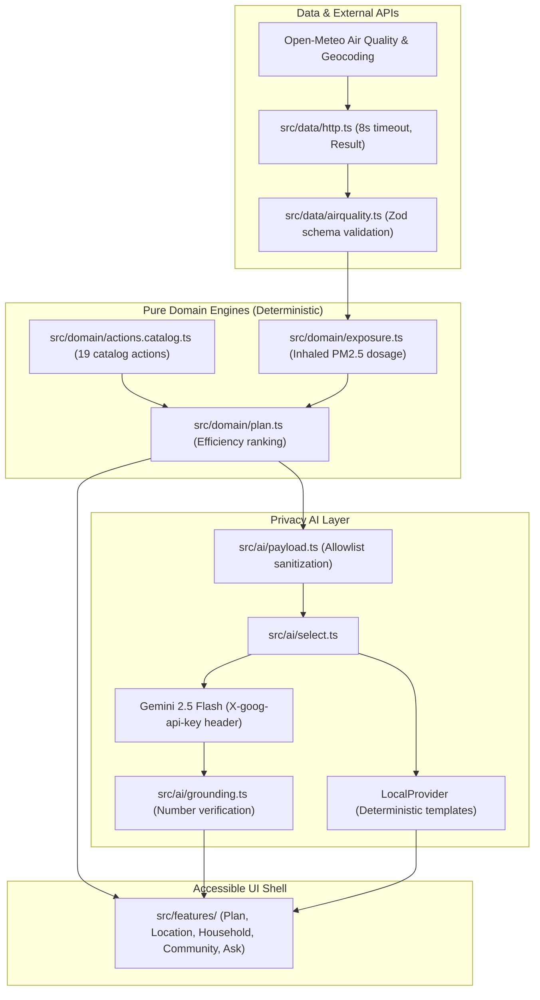

# Saans

> Urban air quality co-pilot calculating personalized inhaled PM2.5 exposure budgets and verified mitigation actions for families experiencing winter smog.

- **Live Application**: https://saans-phi.vercel.app
- **Security Headers**: Security headers (frame-ancestors, nosniff, HSTS) are sent by the Vercel deployment via vercel.json. The GitHub Pages build serves the same app without those headers. (`npm run test -- tests/csp.test.ts`, `curl -sI https://saans-phi.vercel.app`)
- **Demo Video (90s)**: [DEMO_VIDEO_URL_PLACEHOLDER]
- **Platform Config Note**: `vercel.json` is the only config file outside build/lint tooling (`git ls-files | grep vercel`), added strictly because Vercel needs it to serve HTTP response security headers that HTML `<meta>` elements cannot enforce (`npm run test -- tests/csp.test.ts`).

## 2. Chosen Vertical and Persona

- **Vertical**: Urban family and community smog co-pilot for severe winter atmospheric pollution.
- **Persona**: An urban parent in a high-smog city (Delhi-NCR, Lucknow, Patna) managing a multi-generational household with a school-age child and an elder with respiratory vulnerability. The parent needs deterministic operational decisions: identifying lower-pollution exercise windows (`src/domain/schedule.ts`, `tests/schedule.test.ts`), comparing commute options and purifier impact (`src/domain/actions.catalog.ts`, `tests/actions.test.ts`), and proposing school activity thresholds at Resident Welfare Association (RWA) meetings without navigating medical jargon or fabricated numbers.

## 3. Problem Statement Mapping

| Challenge Phrase                 | Visible Feature                                                                                                | Source Files                                                                   | Test Evidence (`npm run test`)                                                          |
| :------------------------------- | :------------------------------------------------------------------------------------------------------------- | :----------------------------------------------------------------------------- | :-------------------------------------------------------------------------------------- |
| severe winter smog               | Diurnal 24h PM2.5 tracking and US EPA AQI band categorization                                                  | `src/data/airquality.ts`, `src/features/location/`                             | `tests/aqi.test.ts`, `tests/data.test.ts`                                               |
| families and communities         | Multi-member household profiles with vulnerability flags & RWA advisory                                        | `src/features/household/`, `src/features/community/`                           | `tests/household.test.ts`, `tests/advisory.test.ts`                                     |
| low-emission daily routines      | Shifted outdoor play, indoor morning workouts, school run timing                                               | `src/domain/actions.catalog.ts`, `src/domain/schedule.ts`                      | `tests/actions.test.ts`, `tests/schedule.test.ts`                                       |
| indoor air quality hacks         | Door gap sealing, damp mopping over dry sweeping, Corsi-Rosenthal boxes                                        | `src/domain/actions.catalog.ts`, `src/config/exposure-constants.ts`            | `tests/actions.test.ts`, `tests/exposure.test.ts`                                       |
| sustainable alternatives         | Public transit over two-wheelers, clean cooking fuels, do not burn waste                                       | `src/domain/actions.catalog.ts`                                                | `tests/actions.test.ts`                                                                 |
| tailored to location             | 8 Indian smog cities with geocoding search and manual PM2.5 fallback                                           | `src/data/cities.ts`, `src/data/geocode.ts`                                    | `tests/data.test.ts`                                                                    |
| tailored to lifestyle            | Household member roles & respiratory flags, UI commute/purifier inputs, and fixed-diurnal action/window models | `src/features/household/`, `src/domain/household.ts`, `src/domain/schedule.ts` | `tests/household.test.ts`, `tests/schedule.test.ts`, `tests/household.feature.test.tsx` |
| clearly explaining direct impact | Deterministic inhaled dose (ug), cigarette-equivalents, and action deltas                                      | `src/domain/exposure.ts`, `src/domain/plan.ts`                                 | `tests/plan.test.ts`, `tests/properties.test.ts`                                        |

## 4. Approach and Logic

- **Exposure Budget Model**: Evaluates cumulative 24-hour inhaled PM2.5 particulate mass:
  $$Dose (\mu g) = \sum_{h=0}^{23} \left[ C_{pm2.5}[h] \times f_{env}[h] \times (1 - \eta_{mask}[h]) \times BR[role] \times (1 - \Delta_{purifier}[h]) + Additions[h] \right]$$
- **Action Deltas**: Impact is computed deterministically as the difference between baseline scenario and action-applied scenario: $\Delta Dose = Dose_{base} - Dose_{action}$ and $\Delta \% = \text{round}((\Delta Dose / Dose_{base}) \times 100)$.
- **AI Never Makes Numbers**: Numerical metrics are computed exclusively by pure TypeScript engines (`src/domain/`). AI only provides conversational wording. Every numeric token in AI output is verified by `numbersAreGrounded` against pre-computed engine values (`tests/grounding.test.ts`).

## 5. How It Works



Architectural decisions are tracked in `docs/adr/` (0001-stack, 0002-layering, 0003-ai-never-makes-numbers, 0004-exposure-budget-engine, 0005-data-privacy-and-gemini, 0006-accessible-component-kit).

## 6. Assumptions and Limits

- **Heuristic Constants**: Inhalation rates (EPA Chapter 6), infiltration factors (EPA IAQ), mask filtration (NIOSH/CDC), and cigarette equivalence divisor (22 ug/m3 via Berkeley Earth) are operational approximations, not medical diagnoses (`src/config/exposure-constants.ts`).
- **AQI Standards**: Open-Meteo returns US EPA AQI breakpoints (`src/config/aqi-constants.ts`); Indian CPCB breakpoints differ slightly.
- **Spatial Resolution**: Regional forecast resolution is ~11 km; immediate roadside microclimates may vary.
- **Forecast vs Observation**: Uses 24-hour atmospheric forecasts from Copernicus CAMS; users can supply measured values via manual entry mode.

## 7. Evaluation Focus Table

| Evaluation Area       | Architectural Strategy                                                       | Source Implementation                                   | Test & Verification Command                                                   |
| :-------------------- | :--------------------------------------------------------------------------- | :------------------------------------------------------ | :---------------------------------------------------------------------------- |
| **Code Quality**      | Max 200 lines/file, max 60 lines/fn, complexity <= 10, zero `any`            | `AGENTS.md`, `eslint.config.js`                         | `npm run lint` && `npm run typecheck`                                         |
| **Security**          | Data minimization payload, CSP headers/meta, 280-char guard, memory-only key | `src/config/csp.ts`, `vercel.json`, `src/ai/payload.ts` | `npm run test -- tests/privacy.canary.test.ts tests/csp.test.ts`              |
| **Efficiency**        | Vite chunk splitting, gzipped bundle < 150 KB, pure calculation cache        | `vite.config.ts`, `src/data/cache.ts`                   | `npm run build`                                                               |
| **Testing**           | >= 85% branch and >= 90% statement/line/fn thresholds, property & HTTP mocks | `tests/*.test.ts`, `vitest.config.ts`                   | `npm run test:cov`                                                            |
| **Accessibility**     | Dual-signal badges, WCAG 2.1 AA axe & contrast checks, SVG data table        | `src/shared/`, `src/index.css`, `e2e/a11y.spec.ts`      | `npm run test -- tests/contrast.test.ts` && `npm run e2e -- e2e/a11y.spec.ts` |
| **Problem Alignment** | 19 catalog actions, 8 Indian cities, personalized exposure budget            | `src/domain/actions.catalog.ts`                         | `npm run test -- tests/actions.test.ts`                                       |

## 8. Privacy and AI Disclosure

The cloud AI payload sent to Google Gemini is restricted to pre-approved categorical fields generated from `src/ai/payload.ts` (`DISCLOSURE_DESCRIPTIONS`):

1. `aqiBandKey`: Categorical air quality band (e.g. `unhealthy`).
2. `roundedPm25`: Ambient PM2.5 rounded integer concentration in ug/m3.
3. `memberKinds`: Demographic role classifications (`child`, `adult`, `elder`).
4. `actions`: Top 5 recommended action IDs with integer percentage deltas.
5. `language`: Interface language code (`en` or `hi`).
6. `userQuestion`: User question text (up to 280 characters, after validation guard).

City names, GPS coordinates, household names, nicknames, member IDs and notes are not sent. Your typed question is sent when Gemini is on (`npm run test -- tests/privacy.canary.test.ts`, `npm run e2e`).

## 9. Run, Test, and Build Commands

```bash
# Install exact pinned dependencies
npm ci --ignore-scripts

# Run complete verification gate (format, types, lint, knip, test:cov, build)
npm run check

# Start local development server
npm run dev

# Run test suite with v8 coverage thresholds
npm run test:cov

# Build optimized production assets
npm run build

# Preview production build locally
npm run preview
```

## 10. Attribution

- **Air Quality & Forecasts**: [Open-Meteo Air Quality API](https://open-meteo.com/) using Copernicus Atmosphere Monitoring Service (CAMS) European Ensemble.
- **Geocoding**: Open-Meteo Geocoding API.
- **Generative AI**: Google Gemini API (`gemini-2.5-flash`, optional user-supplied key).
